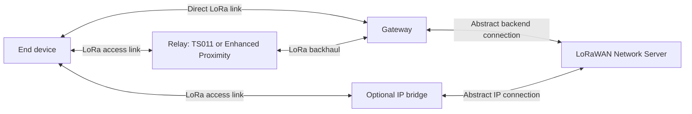
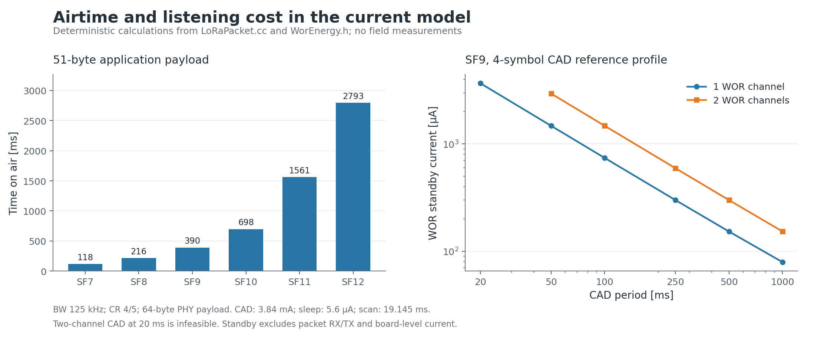
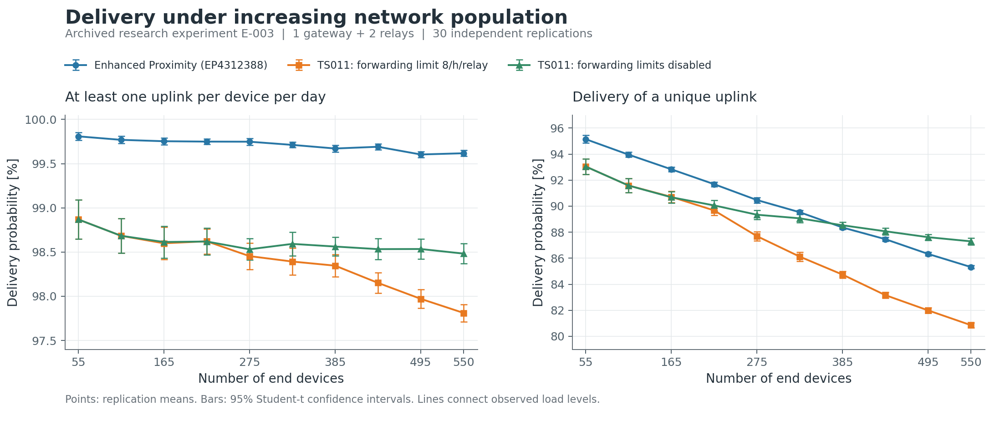

# LoRa Relay Simulator

**A discrete-event research simulator for LoRaWAN coverage extension, relay access and energy consumption, built with OMNeT++.**

The simulator follows communication from an end device through a direct or relayed radio link to a LoRaWAN Network Server (LNS). It supports comparisons between additional gateways, LoRa Alliance TS011 relays, **Enhanced Proximity (EP)** relaying and an optional IP bridge. It was developed in connection with Artur Frankiewicz's doctoral research into reliable, energy-efficient communication in large metering networks.

The public `future-development` branch contains the current development model. It is intended for research, scenario comparison and investigation of protocol behaviour. The implemented scope and assumptions are described below so that results can be interpreted and reproduced correctly.

[Architecture](#network-architecture-and-modelled-layers) · [Mechanisms](#implemented-mechanisms) · [Enhanced Proximity](#enhanced-proximity-relaying) · [Example figures](#example-figures) · [Getting started](#getting-started) · [Contact](#contact-and-collaboration)

## Research scope

The tool can be used to investigate:

- delivery of individual uplinks and the probability of receiving at least one report from a device during a day;
- coverage gaps, relay placement and the effect of adding gateways;
- network population, reporting-window duration and the number of reports per window;
- fixed spreading factors and adaptive data rate (ADR);
- the airtime, receive-window and energy costs of different relay-access mechanisms;
- clock uncertainty, relay listening time and TS011 channel activity detection (CAD);
- the effect of forwarding limits and the optional multichannel gateway model.

## Network architecture and modelled layers



*Figure 1. Communication paths represented by the model. Radio access, relay forwarding and backend processing are separate components; backend connections are abstracted rather than simulated as a full IP stack.*

| Layer or function | What is represented | Main implementation |
|---|---|---|
| Physical / radio | LoRa packet airtime, SF-dependent reception threshold, distance-dependent path loss, random propagation variation, collisions, capture and half-duplex operation | [`Radio`](src/Radio.cc), [`LoRaPacket`](src/LoRaPacket.cc) |
| MAC / link access | Join, acknowledgements, serialized device transactions, Class A receive windows, retry/fallback policies and relay access | [`LogicEndnode`](src/LogicEndnode.cc), [`LogicRelay`](src/LogicRelay.cc) |
| Network-server functions | Reception from multiple gateways, duplicate handling, gateway selection for replies, Join responses, ACKs, ADR decisions and relay encapsulation handling | [`LNS`](src/LNS.cc) |
| Application traffic | Configurable reporting windows, report counts and payload size; scheduled opportunities may be used for Join until a session is established | [`LogicEndnode`](src/LogicEndnode.ned), [`WindowSchedule`](src/WindowSchedule.h) |
| Backend / transport abstraction | Gateway-to-LNS connections and an optional IP bridge with configurable attach/transmit charge | [`Gateway`](src/Gateway.ned), [`LogicIpBridge`](src/LogicIpBridge.cc) |
| Cross-layer accounting | Delivery, device state, delay, radio activity, charge consumption, topology and diagnostic exports | [`Keeper`](src/Keeper.cc) |

This is a custom OMNeT++ model. A packet-level TCP/IP stack, routing protocols and application-server services are outside its scope.

## Implemented mechanisms

### LoRa PHY and spreading factor (SF)

The model supports **SF7–SF12**. Spreading factor affects symbol duration, time on air and the reception threshold. Packet airtime includes the preamble and payload overhead; SF11 and SF12 use low-data-rate optimisation. The current PHY calculation uses **125 kHz bandwidth, coding rate 4/5 and an explicit header**. Bandwidth and coding rate are therefore fixed assumptions in this version.

Received power is calculated from distance and transmit power, with a configurable Gaussian propagation term. Reception then uses a threshold and collision/capture rules. The SNR field exported by this branch is a derived diagnostic value; the current receiver does not directly evaluate the empirical SNR–delivery logistic curves discussed in the thesis.

### Adaptive data rate (ADR)

Set `forceSF = -1` to enable the model's adaptive-SF mode, or set a value from 7 to 12 for a fixed SF. The LNS compares the received link margin with `ADRtarget` and `ADRtolerance` and includes an increase/decrease instruction in an ACK. The device applies a one-step SF adjustment. Missing responses trigger the configured recovery logic and an ADR reset.

This is a simplified, margin-based ADR algorithm. It does not implement the complete LoRaWAN MAC-command negotiation or adaptive transmit-power control.

### Join, ACKs and receive windows

The end-device state machine distinguishes unjoined/joined operation and direct/relayed routes. It models JoinRequest and JoinAccept exchanges, response timeouts, retries and transition to relay assistance. Ordinary Class A RX1/RX2 windows start 1/2 seconds after transmission; Join receive windows start 5/6 seconds after transmission. A successful response closes the pending exchange and cancels the unnecessary receive window.

ACK frequency is configurable through `ackEvery`. Device, message and attempt identifiers associate responses with the correct transaction. The LNS handles duplicate receptions, while delivery statistics avoid counting a retry as a new application message. `startJoined` is available for experiments that begin with an operational network.

Join and session handling are behavioural models: byte-level AES, session-key derivation and provisioning are not simulated.

### LoRa Alliance TS011 relay

The implementation covers the **Class A, single-hop research subset of [TS011-1.0.1](https://resources.lora-alliance.org/home/ts011-1-0-1-relay)** needed for relay comparisons:

- periodic CAD scans, one or two WOR channels, and variable wake-on-radio preambles;
- WOR and WOR ACK exchanges, synchronization states, clock uncertainty and preamble-length adaptation;
- separate timing for Join access and ordinary uplinks;
- `ForwardUplinkReq` / `ForwardDownlinkReq`, FPort 226, encapsulation overhead and reception metadata;
- RXR handling for relayed downlinks;
- static Join filtering with longest-prefix matching;
- Join, per-device, trusted-device and global forwarding token buckets, including an unlimited mode;
- forwarding status, holdoff and maximum-payload checks.

Route-activation thresholds are experiment parameters. For example, a research profile may fall back to a relay after one missed expected ACK; this is an experiment policy, not a claim that this threshold is a normative TS011 controlled-mode setting. EP and TS011 configurations must be compared with these policy differences in mind.

See the [TS011 implementation notes](docs/TS011_IMPLEMENTATION.md) for protocol details. The later [dynamic WOR energy update](docs/E006_DYNAMIC_WOR_ENERGY.md) and [multichannel update](docs/multichannel_2026-09-28.md) supersede the older notes where they describe a constant WOR current or the absence of multichannel gateway reception.

### Optional multichannel operation

`lorawanMultichannel = true` enables uniformly selected direct-Join channels 1–3 and joined-device uplink channels 1–8. The gateway can receive overlapping frames on independent logical frequencies. Its own transmission interrupts reception and blocks new reception across the channels.

Within a channel, the current model uses a pairwise **6 dB capture approximation**. It does not include a detailed concentrator demodulator allocation model, adjacent-channel interference or an inter-SF interference matrix. ED and relay radios retain a single half-duplex RF chain. ED–relay access and relay backhaul continue to use their configured channels. Legacy scenarios keep this extension disabled by default.

## Enhanced Proximity relaying

**Enhanced Proximity (EP)** is the name used here for the relay approach identified as `EP431` in the source code and associated with European patent application **EP4312388A1**.

The method uses knowledge of the network and predictable rendezvous times to provide relay assistance with short, scheduled listening periods. The protocol concept is:

1. **Identify a loss of connectivity.** Missing reports at the network side and missing expected acknowledgements at the device side indicate a persistent communication problem.
2. **Designate a suitable relay.** Network knowledge, including device and relay locations, supports selection of the assisting relay.
3. **Establish a shared rendezvous schedule.** Device-specific information and shared changing parameters determine pseudorandom transmission offsets known to both sides.
4. **Listen near the expected transmission time.** The relay opens a receive interval wide enough to accommodate clock uncertainty. This reduces the need for a long wake-up transmission before every relayed uplink.
5. **Forward the exchange.** The relay receives the device frame, forwards it towards the LNS and provides the return path for the response.

The intended benefit is reduced wake-up airtime and controlled relay listening cost. The resulting trade-off depends on traffic, clock accuracy, propagation, relay activation and the cost of forwarding.

### Representation in this simulator

The simulator retains scheduled reporting, the configurable missing-response threshold, relay eligibility, a clock-drift-dependent receive interval, forwarding and response timing. The listening interval grows with elapsed time since the last ACK and `clockDriftMax`.

The rendezvous is implemented using an internal OMNeT++ wake-up event. It represents prior schedule knowledge and is **not an extra over-the-air packet**. Relay designation and schedule distribution are abstracted; the branch does not implement the complete network-management exchange, a geographic relay optimiser or every channel-selection option described by the patent. The patent concept and the simulation abstraction should therefore be distinguished when reusing the model.

### Patent protection and implementation enquiries

The method is the subject of European patent application **EP22461583.1**, published as **[EP4312388A1 — “A method of transmitting data, a relay and end-device”](https://patents.google.com/patent/EP4312388A1/en)** on 31 January 2024, with a filing date of 26 July 2022. The named inventors are Krzysztof Grochla, Artur Frankiewicz and Zbigniew Łaskarzewski; the listed applicants are AIUT Sp. z o.o. and the Institute of Theoretical and Applied Informatics, Polish Academy of Sciences.

The [European Patent Register](https://register.epo.org/application?number=EP22461583&tab=main) is the reference for the current procedural status and patent documents. This README identifies the published application rather than making a statement about the current scope or territorial effect of granted rights.

**If you are interested in implementing or using Enhanced Proximity, please contact Artur Frankiewicz to discuss the intended application, collaboration and any patent-related or licensing arrangements with the relevant rights holders.** See [Contact and collaboration](#contact-and-collaboration). Existing software-license notices in individual source files should also be consulted.

## Energy and clock models

The simulator accumulates current over time for sleep, listening, receive, transmit and WOR states, with an optional constant board-level offset. The accumulated quantity is charge, expressed in **mA·s**, from which average current can be calculated. Device and relay currents can be configured separately. Optional IP-bridge attach and transmission costs are modelled as additional charge.

The current TS011 model calculates WOR standby current from the CAD period, number of WOR channels, CAD scan duration and sleep/CAD currents. It uses a reference SX126x scan-duration profile. Invalid settings that require overlapping scans on one RF chain are rejected. This is a configurable radio-energy model, not a complete model of battery ageing, temperature-dependent capacity or a particular finished product.

Clock uncertainty affects relay listening and synchronization. The common research setting is 40 ppm, while individual experiment files can override the drift and TS011 clock-accuracy parameters.

## Example figures



*Figure 2. Deterministic characteristics of the current model: time on air for a 51-byte application payload, and WOR standby current for an SF9 reference CAD profile. These are calculations from `LoRaPacket.cc` and `WorEnergy.h`, not hardware measurements. Parameter values and exclusions are printed in the figure.*



*Figure 3. An archived doctoral-research experiment with one gateway, two relays and 55–550 end devices. Points are means over 30 independent replications; bars show 95% Student-t confidence intervals. The left panel measures daily service availability; the right panel measures unique-uplink delivery. This E-003 experiment predates later frequency-separation, energy and multichannel updates; it illustrates the analysis workflow rather than reporting a new benchmark of the current branch.*

The [figure notes and CSV data](docs/examples/README.md) document the scenarios, metric definitions and provenance. Results from a particular topology should not be treated as universal performance guarantees.

## Getting started

### Requirements

- **OMNeT++ 6.x**, with its C++ compiler and build tools; development has used OMNeT++ 6.4 on Windows.
- The NED and C++ model sources in this repository. An external INET installation is not required by the current project files.
- Python only for optional analysis and plotting; the simulator itself is C++.

Clone the project and import its existing `.project` into the OMNeT++ IDE, or build from an **OMNeT++ shell**:

```bash
git clone https://github.com/sirartii/lora_relay.git
cd lora_relay/src
opp_makemake -f --deep -o opp-lora-relay-official
make MODE=release
cd ..
```

The explicit output name keeps the following commands independent of the checkout directory name. On Windows the executable has an `.exe` suffix.

Run a short EP example in its own output directory:

```bash
mkdir -p out/readme-ep
cd out/readme-ep
../../src/opp-lora-relay-official -u Cmdenv \
  -n ../../simulations:../../src \
  -f ../../simulations/omnetpp.ini -c EP431_Reference \
  --sim-time-limit=1d --warmup-period=0s --repeat=1 \
  --record-eventlog=false --result-dir=.
```

For TS011, use a separate output directory and select `TS011_Default` or `TS011_DualChannel`. Use `-u Qtenv` for interactive inspection. A one-day run is a functional example; research comparisons require an appropriate warm-up, observation period and independent repetitions.

On Windows, use `.exe` for the executable and a quoted semicolon-separated NED path: `-n "../../simulations;../../src"`. The command above uses the Unix path-list separator.

### Configuration families

| File | Purpose |
|---|---|
| [`simulations/omnetpp.ini`](simulations/omnetpp.ini) | General settings, EP reference, TS011 default/dual-channel configurations and parameter sweeps |
| [`simulations/omnetpp_chapter7.ini`](simulations/omnetpp_chapter7.ini) | Doctoral-study scenario configurations |
| [`simulations/omnetpp_review.ini`](simulations/omnetpp_review.ini) | Controlled comparative and sensitivity-study profiles |
| [`simulations/MeasuredNetwork.ned`](simulations/MeasuredNetwork.ned) | Topology support for measured-network experiments |

Useful parameters include `retransmissionModel` (`1` = TS011, `2` = EP431), `forceSF`, `clockDriftMax`, `windowsPerDay`, `framesPerWindowMin/Max`, reporting-window duration, `applicationPayloadLength`, `ackEvery`, relay activation thresholds and TS011 forwarding limits. Always inspect the selected configuration and its inherited values: defaults are not identical across study profiles.

## Outputs and reproducibility

The model can produce OMNeT++ scalar/vector results and additional text, CSV or JSON diagnostics. Depending on enabled options, these include:

- per-device delivery and topology records;
- message identities, Join/data flags, retry counts and actual relay transmissions;
- delivery delay, radio airtime, charge and average-current summaries;
- TS011 synchronization, forwarding-limit and payload-limit counters;
- multichannel gateway reception outcomes such as sensitivity loss, collision and gateway-TX blocking.

`exportFrameRecords` enables detailed message diagnostics, and `exportGatewayReceives` enables multichannel reception traces. Some exporters use fixed filenames or append to existing files. **Run each replication in a separate working directory.** Record the commit, configuration, overrides, seed, warm-up, duration and analysis version alongside the results. When reporting uplink delivery, state whether Join is included and how retries are deduplicated.

### Plotting scripts and additional materials

**Plot generation is performed outside the C++ simulator.** The separate [`scripts/`](scripts/) directory contains analysis and plotting utilities already shared with this repository; these are not part of the simulator's execution engine. See the [scripts README](scripts/README.md) and [Python requirements](scripts/requirements.txt).

**Additional plotting scripts, complete research workflows and supporting materials can also be shared on request. If you would like to reproduce a particular figure or adapt the analysis to your own network, please contact me.** Some existing utilities retain paths and labels from the original research environment and may need configuration for another machine.

## Model boundaries and further work

The main boundaries of the current version are:

- Class A and single-hop relaying; Class B/C and multihop forwarding are outside the implemented scope.
- Research-level PHY and interference abstractions, rather than waveform simulation or a calibrated concentrator model.
- Simplified ADR, Join/session and backend behaviour; no byte-level cryptographic stack or runtime Relay MAC-command management.
- Abstract EP designation and rendezvous control; no complete deployment-management service.
- Scenario-specific propagation and current parameters that require calibration for a new installation.

Natural extensions include richer inter-SF and adjacent-channel interference, hardware-calibrated CAD behaviour, dynamic relay selection, broader propagation validation and energy models fitted to additional devices. Existing tests and experiment notes are available under [`scripts/tests/`](scripts/tests/) and [`docs/`](docs/).

## Contact and collaboration

**Artur Frankiewicz — [GitHub: @sirartii](https://github.com/sirartii).**

I welcome enquiries from researchers and organisations interested in the simulator, Enhanced Proximity, relay deployment, validation against operational data or access to additional analysis materials. To start a discussion, [open an issue](https://github.com/sirartii/lora_relay/issues/new) describing your use case and the material you need. We can then arrange a suitable channel for technical, commercial or patent-related discussions.

When using the model in research, please cite the repository together with the exact commit and configuration. For Enhanced Proximity, also cite the patent publication linked above. TS011 is specified by the LoRa Alliance; this simulator is an independent research implementation.
